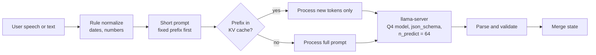
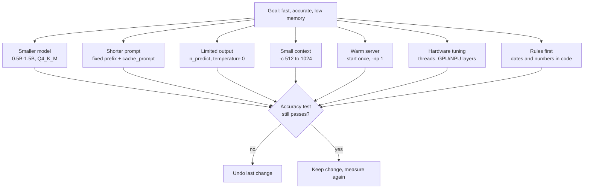

# Diagram: Optimizing On-Device Slot Filling on a Phone

## 1. Request pipeline (what runs on each turn)



## 2. Where the time goes

```
Total latency
├── Load model          (avoid: start server once)
├── Read prompt         (reduce: short prompt + cache_prompt)
│   └── Prefill tokens
└── Write output        (reduce: n_predict = 64, JSON stops early)
    └── Decode tokens
```

## 3. Optimization levers



## 4. Lever table

| Lever | Change | Effect | Risk |
|---|---|---|---|
| Model size | 1.5B → 0.5B, Q4_K_M | Less memory, faster decode | Lower accuracy |
| Prompt cache | `cache_prompt: true`, fixed prefix first | Less prefill per turn | Prefix must not change |
| Output limit | `n_predict: 64` | Stops long output | Truncated JSON if too small |
| Context | `-c 1024` instead of 4096 | Less memory per step | Long dialogs need state trimming |
| Warm server | Start `llama-server` once | Removes load time | Background memory use |
| Threads | Match fast cores (test 2 / 4 / 6) | Faster inference | Heat and battery |
| Rules | Normalize dates and numbers in code | Fewer model errors | More code to maintain |

## 5. Measurement loop

```
 Baseline ──► change ONE lever ──► measure latency + memory
    ▲                                      │
    │                                      ▼
  undo ◄──── accuracy drop? ◄──── accuracy test on same set
                                           │ no drop
                                           ▼
                                    keep, next lever
```
