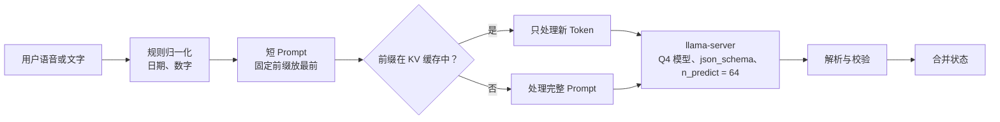
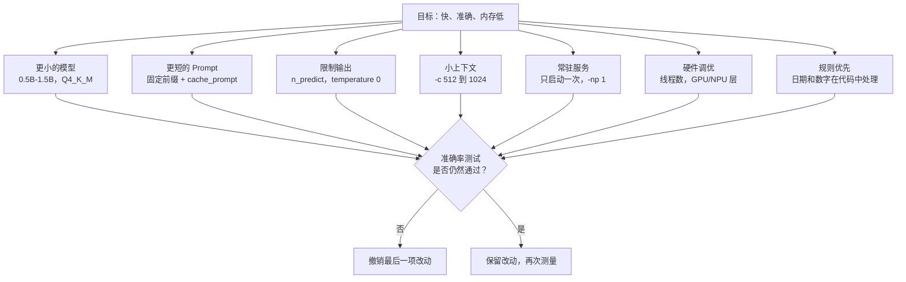

# 图示：如何在手机上优化端侧槽位填充

## 1. 请求流程（每一轮都会执行）



## 2. 时间花在哪里

```
总延迟
├── 加载模型        （避免：只启动一次服务）
├── 读取 Prompt     （减少：Prompt 变短 + cache_prompt）
│   └── Prefill Token
└── 写出输出        （减少：n_predict = 64，JSON 闭合即停）
    └── Decode Token
```

## 3. 优化杠杆



## 4. 杠杆一览表

| 杠杆 | 改动 | 效果 | 风险 |
|---|---|---|---|
| 模型大小 | 1.5B → 0.5B，Q4_K_M | 内存更少，解码更快 | 准确率下降 |
| Prompt 缓存 | `cache_prompt: true`，固定前缀放最前 | 每轮的 prefill 更少 | 前缀不能改变 |
| 输出上限 | `n_predict: 64` | 限制过长输出 | 太小会截断 JSON |
| 上下文 | 用 `-c 1024` 代替 4096 | 每一步内存更少 | 长对话需要裁剪状态 |
| 常驻服务 | 只启动一次 `llama-server` | 去掉加载时间 | 后台占用内存 |
| 线程数 | 与快核数量匹配（测试 2 / 4 / 6） | 推理更快 | 发热和耗电 |
| 规则 | 日期和数字在代码中归一化 | 模型出错更少 | 需要维护更多代码 |

## 5. 测量循环

```
 基线 ──► 只改一项杠杆 ──► 测量延迟与内存
   ▲                              │
   │                              ▼
 撤销 ◄──── 准确率下降？ ◄──── 同一测试集测准确率
                                  │ 没有下降
                                  ▼
                           保留改动，改下一项
```
